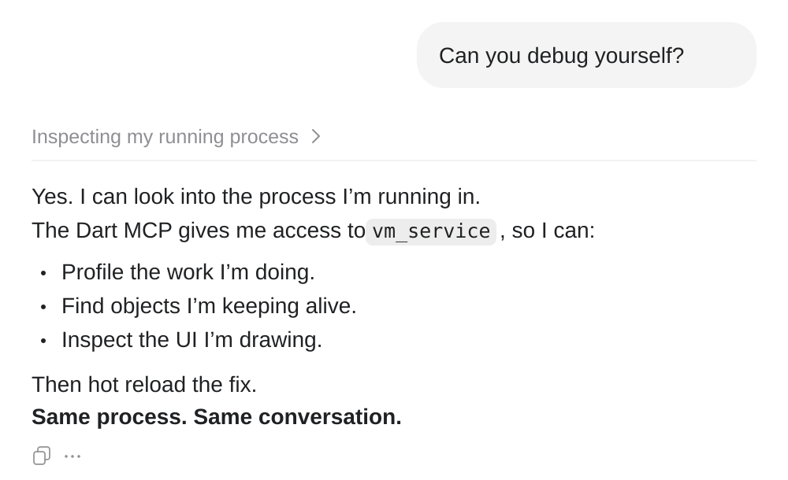

Smalltalk imagined a world of living objects: you could inspect them,
change their behavior, and keep going. I want an AI agent to live in a
world like that.



The illustration sketches the interaction I want. A human asks, “Can you
debug yourself?” The agent is the one answering. Behind its reply, the
[Dart and Flutter MCP server](https://github.com/dart-lang/ai/blob/main/pkgs/dart_mcp_server/README.md)
gives it access to the running application: runtime errors, VM Service
methods, and Flutter's widget inspector. The tools supply observations;
the agent uses them to decide what to change.

With its own source in its workspace, it could investigate a slow operation,
edit the code responsible, reload it, and inspect the result. I want that to
happen inside the conversation we are already having. The work in progress
is part of the thing I want to preserve.

That wish has a history much older than AI coding agents.

## The world as it should be

In [Utopia and Dystopia: Smalltalk and the Wider World](https://www.youtube.com/watch?v=BDwlEJGP3Mk),
Gilad Bracha calls Smalltalk “a vision of the world as it should be.” He
imagines a history in which Smalltalk won: its ideas are everywhere, its
community has overcome its weaknesses, and the rest of us live in that
better world. The talk is a satire, affectionate and impatient with the
distance between what programming could be and what we have settled for.

<iframe class="my-8 block aspect-video w-full" src="https://www.youtube-nocookie.com/embed/BDwlEJGP3Mk" title="Gilad Bracha — Utopia and Dystopia: Smalltalk and the Wider World" loading="lazy" referrerpolicy="strict-origin-when-cross-origin" allow="encrypted-media; picture-in-picture; fullscreen" allowfullscreen></iframe>

Common Lisp offers its own version of this continuity. Its
[class-redefinition protocol](https://www.lispworks.com/documentation/HyperSpec/Body/04_cf.htm)
allows a class to change while existing instances retain their identity.
Slots can be added or removed; programs can specialize
[`update-instance-for-redefined-class`](https://www.lispworks.com/documentation/HyperSpec/Body/f_upda_1.htm)
to carry old values into the new representation. An object can acquire
a different shape and still be the object whose history matters to you.

Smalltalk and Common Lisp would have been natural homes for a program that
works on itself. What I wanted to discover was how much of that experience
I could bring into a modern desktop application, with the libraries and
deployment tools I wanted to use.

## The application I want

By the agent's implementation, I mean the software around the model: its
task loop, context management, tool orchestration, storage, and user
interface. I want the agent to be able to examine and change that software.
Debugging itself is one use of that ability.

Suppose I ask it to spend fewer tokens. It might change how it selects
context, summarizes tool output, or groups operations into model calls.
If I ask it to complete more tasks, it might change how it decomposes work
or recovers from failures. If I care about latency, it might change which
operations run concurrently. I supply the direction; the agent experiments
with how to get there, and we need a way to tell whether its changes helped.

I want a desktop application where I can direct that work and see what is
happening. I also want to run the agent headlessly on a VPS. In both places,
I want ordinary procedures and data structures, with as little custom reload
machinery as I can get away with.

And when I ship a version, I want to compile the host ahead of time to native
code, without carrying its development compiler and JIT into every release.
That is a different stage from the live environment where the agent
experiments with itself. I want a language that is comfortable in both.

## The browser already has much of this

JavaScript and TypeScript belong in this story. A browser application
developed with [Vite's hot module replacement](https://vite.dev/guide/features.html#hot-module-replacement)
can change while it is running, and framework integrations can preserve UI
state through those updates. Pair that with
[Chrome DevTools MCP](https://github.com/ChromeDevTools/chrome-devtools-mcp/),
and an agent can inspect the live page, examine network requests and console
messages, take screenshots, and record performance traces. Much of the
interaction in the opening illustration is already possible in that world.

Vite supplies the development workflow; the browser runs the application.
Its [HMR boundaries](https://vite.dev/guide/api-hmr.html) determine how updates
propagate, with the framework or application arranging what state survives.
An agent with long-running work still has to be designed around that model.

There is now a native AOT path in this ecosystem too.
[Bun's AOT compiler](https://github.com/oven-sh/bun/pull/45631), merged on
October 27, 2026, adds `bun build --compile --aot`: JavaScript and TypeScript
compiled to machine code ahead of time, with no JIT in the executable.
The work is experimental and has documented compatibility and platform
limits, but native compilation is already a concrete option for a Bun host.
The Vite frontend remains a browser application.

I expect this kind of AOT work to reach Electron applications too. Bun's
compiler targets JavaScriptCore, while
[Electron combines Node.js and Chromium](https://www.electronjs.org/docs/latest/tutorial/process-model),
so bringing it there is a separate piece of engineering.

This makes TypeScript a serious alternative. I haven't run the behavior
probes below against Vite or Bun, so they establish no ranking against that
stack. For this project, I also wanted to explore a runtime and desktop UI
with a shared live-development workflow. That brought me to Dart with
Flutter, alongside the C# and .NET MAUI application I was already building.

## What exactly survives an edit?

An agent makes the meaning of “hot reload” unusually concrete. It has a
conversation, open connections, and operations waiting on model responses
or tool results. Some of its code can remain active for minutes. After an
edit, which code does that work continue through? Which objects keep their
identity and values?

Changing a function body is one part of the question. An agent may also
want to simplify the data structures it uses. I ran into that distinction
while developing Happen as a .NET MAUI application targeting
`net11.0-maccatalyst`. I removed the `sendShortcut` field. With the local
file path shortened, this was the response:

```text
[ui] dotnet watch ❌ [Happen.App (net11.0-maccatalyst)] MainPage.cs(3,1): error ENC0033: Deleting field 'sendShortcut' requires restarting the application.
[ui]   ❔ Do you want to restart your app? Yes (y) / No (n) / Always (a) / Never (v)
```

A small edit had reached all the way out to the lifetime of the application.
This was the continuity Smalltalk and Common Lisp had made me think about:
an object already exists, already has a history, and now I want to change
what it is. I wanted to see exactly where Dart and .NET drew that boundary.

## Giving the running program something to lose

I reduced the application to two small servers: one in plain Dart and one
in ASP.NET Core. Each created a typed state object, a registered named
callback, a closure, and an async operation waiting on a gate controlled by
the probe. Each also accepted a WebSocket connection.

The counter started at `73`. Before editing the source, the controller changed
it to `97` over HTTP and opened the WebSocket. That gave the test actual state
to lose: a restart would produce a new session and restore the counter to
`73`. The closure captured `73` before that mutation, so I could check its
captured value separately from its function body.

I ran these fresh probes on November 1, 2026, on an M1 Pro Mac with 16 GiB
of RAM and macOS 26.4. The runtimes were Dart 3.13.7 and .NET
11.0.0-rc.3.26522.148, using SDK 11.0.100-rc.3.26522.148. The .NET SDK was the
preview toolchain installed for the MAUI application.

I applied Dart edits through the VM Service's `reloadSources` operation.
For .NET, I used `dotnet watch --non-interactive`. That option
[automatically restarts on unsupported edits](https://learn.microsoft.com/en-us/dotnet/core/tools/dotnet-watch#options),
allowing the probe to observe the result rather than stop at a prompt.
A passing live update had to expose the changed code in the same process and
session, retain the counter at `97`, and answer through the original WebSocket.

These were the results for class instances:

| Edit or observation | Dart 3.13.7 | .NET 11 preview |
| --- | --- | --- |
| Delete an existing field | Reloaded; state and original socket preserved | Restarted; state reset and original socket closed |
| Add an integer field initialized to `42` | Existing object read `42`; other state preserved | Existing object read `0`; other state preserved |
| Change a registered named callback's body | Updated | Updated |
| Change a previously captured closure's body | Kept its old body and captured value | Updated its body; retained the captured value |
| Change a procedure suspended at `await` and its helper | Old continuation called the updated helper | Updated continuation called the updated helper |
| Rename the helper used by the suspended procedure | Old procedure kept calling the old helper in this probe | Resumed procedure called the replacement |

I repeated field deletion in three independent launches for Dart classes,
.NET classes, and .NET structs. Dart preserved the process, counter, and
original socket in all three. .NET restarted in all three class cases and
all three struct cases. Adding a field to a .NET struct also required a restart
in its separate probe.

For the other scenarios, the table reports one run each. The reported set
contains sixteen probe runs, each starting from a fresh process. These are
observations about specific edits, not an exhaustive catalog of supported
changes or a reload-speed benchmark.

The table gave “hot reload” a more precise meaning. .NET updated more of the
code already held by closures and continuations in these probes. Dart let
me change the shape of the existing object through edits that made .NET
restart. For the agent I want to build, that second ability carries more
weight: changing how it represents its work is part of changing how it works.

Even an accepted edit needs inspection. In the C# class probe, the new field
declared with an initializer of `42` read as `0` on the existing instance.
Dart supplied `42` in the corresponding edit. Keeping an object alive
doesn't mean replaying its construction as though it had always had the new
definition. That takes us back to the tools in the illustration: the agent
needs to observe the state it actually has after its edit.

## Where the state has to go

The MAUI error agrees with Roslyn's
[supported-edit matrix](https://github.com/dotnet/roslyn/blob/main/docs/wiki/EnC-Supported-Edits.md),
which excludes fields from the members that can be deleted during Hot Reload.
Microsoft's [diagnostic reference](https://learn.microsoft.com/en-us/visualstudio/debugger/edit-and-continue-errors)
identifies `ENC0033` as a deletion requiring a restart.

The standalone .NET 11 probes make the consequence concrete. This restriction
doesn't depend on a MAUI page failing to redraw or a XAML reload mechanism
being misconfigured. Removing a field from the server's state was enough
to restart it.

Looking beyond those two runtimes, I found a related boundary in Rust's
Subsecond. Its
[struct-layout documentation](https://docs.rs/subsecond/0.7.10/subsecond/#struct-layout-and-alignment)
explains that code compiled for a changed layout cannot safely use existing
instances with the old layout. The framework must dispose of or replace
affected state. Subsecond doesn't automatically migrate those structs.
This part of the comparison comes from its documented behavior; I didn't
run Rust in the Dart/.NET probes.

Here the application has to arrange what happens to state whose layout has
changed. I could build a protocol for reconstructing it, or keep the agent
within edits that preserve existing layouts. Either choice would shape the
way the agent is allowed to work on itself.

Recovering saved conversation history is useful, but a conversation log
doesn't recreate an open stream or an operation halfway through a tool call.
Restarting and replaying work can also repeat side effects. The runtime's
ability to preserve the live application therefore matters independently of
how quickly it can compile a replacement.

Dart did more of that work for me in the probes: it changed the object,
kept its other values, and continued using the existing connection. That
answered the question about live data. The code already running inside
that world raised another one.

## The code already in motion

A suspended procedure has a history too. Dart's
[hot-reload semantics](https://github.com/dart-lang/sdk/blob/main/runtime/docs/hot-reload.md)
preserve function bodies already captured by closures and stack frames.
Later calls can use updated implementations. That explains the combination
in the table: an old async continuation called a newly implemented helper.

The rename probe exposed another consequence. New calls saw the replacement
helper, while the suspended Dart procedure continued calling the old helper.
The source on disk and the work already in progress were executing different
versions of that part of the program.

Happen has also encountered the other failure mode during a real refactor:
a running task resumed and tried to call a helper that had been removed.

```text
NoSuchMethodError: No top-level method 'mcpContext' declared.
Receiver: top-level
Tried calling: mcpContext()
```

That task's history survived, but its turn failed. The small rename probe
didn't reproduce that exception, so retaining a removed helper in one edit
isn't something I can assume for every refactor. The application has to keep
entry points available while active work still depends on them.

I want the agent loop to keep task state outside long-lived closures and
move through short steps that enter the current implementation. A
compatibility function can stay available until older work has finished
using it. If I cancel or retry a step, I also have to account for the
underlying operation and any side effects it has already produced.

Dart has structural limits as well. The VM treats a field rename as removal
and addition; it can't infer that the new field should inherit the old
field's value. Changes such as altering a class's number of type parameters
or converting a class to an enum require a restart. I have also encountered
a Dart VM crash during a structural edit. The successful probes here establish
the behavior of these cases, while reliability across a whole application's
refactors still needs testing.

I still have engineering to do around work in flight. The useful starting
point is that ordinary field additions and removals can happen while the
rest of the application stays alive. I can build the agent's transitions
around that continuity.

## The conversation has a user interface

The probes reduced the application to an object, a server, and a socket.
The agent I want also has a screen. Flutter brings the same Dart runtime
into that desktop UI. After an accepted
[stateful hot reload](https://docs.flutter.dev/tools/hot-reload), it rebuilds
the widget tree against retained state. That makes it possible to change a
view and inspect the result while staying in the current conversation.

The rebuild doesn't rerun `main()` or `initState()`, and it doesn't replace
a suspended agent loop. Initialization and ongoing work still need the
handling described above. Changes to native Swift, Objective-C, Kotlin, or
Java code require a full restart. I want to keep the agent loop and as much
of the application behavior as possible in Dart, where the live-development
workflow applies.

Now the opening illustration becomes a workflow for the whole application.
Through the MCP connection, the agent can inspect the running UI and runtime,
then request a reload after editing its source.
[DevTools](https://docs.flutter.dev/tools/devtools) supplies UI, CPU, and
memory inspection for a human developer; the
[VM Service](https://github.com/dart-lang/sdk/blob/main/runtime/vm/service/service.md)
exposes the runtime protocol behind profiling and heap analysis to tools.

I want the agent to follow evidence through that loop: find where time or
memory is going, connect it to its implementation, make an edit, and look
again. Making every diagnostic useful to it still takes integration work.
And a heap snapshot or widget tree cannot tell me whether it became better
at completing tasks. I will still need evaluations of task completion,
token use, and elapsed time.

Flutter matters because the application I use to direct the agent can
participate in the same development loop as the agent itself.

## Shipping the result

The live environment is where I want the agent to experiment. When I am
ready to ship a version, Dart's
[native compilation](https://dart.dev/tools/dart-compile) can produce a
self-contained executable for the headless host. Flutter has
separate [development and release modes](https://docs.flutter.dev/testing/build-modes)
for the desktop application. The shipped AOT host doesn't hot reload itself;
accepted implementation changes must be rebuilt and deployed.

The agent also needs code mode: writing small programs that compose tool
calls during a session. That is useful in a released application too. It
doesn't require the tool program to use the host's language.

I'm choosing an embedded JavaScript interpreter for that role.
[QuickJS](https://bellard.org/quickjs/) is a small embeddable engine that can
execute those programs inside the host process. Dart owns the application
and its state; the interpreter runs tool programs through a bridge whose
capabilities, limits, and cancellation the host controls.

During development, the agent can edit its Dart implementation and reload
it. In an AOT release, it can still write new tool programs for the embedded
interpreter. Shipping native code and letting the agent compose new
operations can coexist, even though changing the host itself still means
building and deploying another version.

## Dart, carrying the idea forward

After following all those details, I found a line in the
[Dart VM's hot-reload document](https://github.com/dart-lang/sdk/blob/main/runtime/docs/hot-reload.md)
that brought me back to the beginning. It describes its semantics as “very
close to those of Smalltalk.” In many Smalltalk implementations, the
document points out, changing a live program is simply how development works.

There are people behind that continuity too. [Gilad Bracha](https://bracha.org/cv.pdf)
worked on Strongtalk before becoming one of Dart's designers. In
[Strongtalk: A Retrospective](https://www.youtube.com/watch?v=dZ0z0DGMSmU&t=219s),
he recalls building a fast Smalltalk just as Java arrived and changed the
market around it. Their related work on a Java VM became HotSpot. Some of
that future arrived under another name.

Dart wins for the application I want to build. The field-deletion experiment
gave me something concrete to trust: I could change a live object's shape
and retain its state and connection. Flutter extends that continuity into
the interface, the runtime tools let the agent inspect its world, and native
compilation gives me a way to ship it. I am choosing that combination.

Smalltalk and Common Lisp showed what it could mean to work inside a living
program. Dart and Flutter carry that vision into the modern application
stack I want to use. Now I want to give an agent a place in that world: to
look at the process it inhabits, change how it works, and stay for the next
question.
