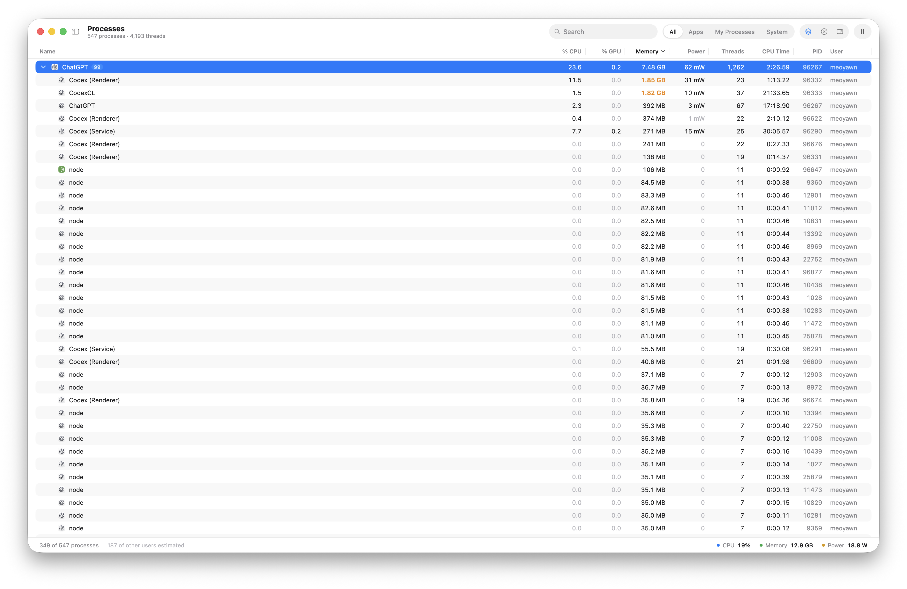

I'm building an AI agent that can modify its own implementation to get better
at whatever its human operator wants it to do. I might want it to complete
more tasks, spend fewer tokens, run faster, or gain a capability it needs for a
new kind of work. The goal comes from me. The agent should be able to change
how it works in pursuit of that goal.

By its implementation, I mean the software around the model: the agent loop,
context handling, tool orchestration, and the application I interact with.
I want that source code to be part of the agent's workspace. It should be able
to inspect its behavior, make a change, try it, and measure whether the change
helped. Fixing a bug is one possible use of that ability.

This first part is about choosing a language for that agent. I want it to run
for a long time, on my desktop and on a VPS. While it experiments with its own
implementation, I want it to preserve its conversation, open connections, and
pending work. Changing how it works should fit into the work it is already
doing.

## The goal drives the change

Suppose I ask the agent to spend fewer tokens on a recurring task. It could
look at which context it sends to the model, how much tool output it carries
forward, or how it groups work into model calls. It could then change that
part of its implementation and compare the next runs. Lower token use only
helps if the result still meets the task's requirements.

If I care about task completion, the useful change might instead be in how it
breaks down work, checks its results, or recovers from an unsuccessful attempt.
That change might spend more tokens. If I care about latency, it might change
how independent operations run concurrently. Nothing has to be broken for
any of these changes to be worth making.

The loop I want is: understand the objective, observe the current behavior,
choose a change, edit the implementation, and evaluate the result. Then keep,
revise, or revert the change. The operator supplies the objective and the
constraints; the agent needs room to experiment with how it meets them.
Choosing useful evaluations is part of this project too. A runtime accepting
an edit doesn't tell me whether the agent became better at its task.

I also want a GUI where I can give the agent direction, see what it is changing,
and inspect the results. That's an opinion about the product I want to build:
the agent should be an application I can see into and interact with. A headless
deployment still matters, but the desktop application isn't an optional
wrapper I'll add later. Its UI framework belongs in the language decision.

That has left me with two strongest contenders: Dart and C# on .NET. Both offer
a serious live-development workflow, official runtime diagnostics, and native
AOT deployment. .NET did better than I expected in my reload experiments. Dart
has Flutter, which brings the UI and the development loop together in a way I
find especially appealing.

The difficult part was working out how those strengths fit a self-modifying
AI agent. I want ordinary procedures, plain data, mainstream libraries, and as
little custom reload machinery as possible. I also want code mode: the agent
writes programs that compose tool calls. Choosing a language for the agent's
implementation doesn't necessarily mean choosing that same language for every
program it runs.

## Three things the runtime has to do

The language decision is about making that loop practical. I need to apply a
change, observe its effects, and eventually ship the resulting application.

First, **change the running program**. I want stateful hot reload while the
agent experiments with its implementation. It should be able to change how it
selects context or schedules work and use that change in the same session.
A watcher that restarts the process after every save loses too much of the
ongoing work.

Second, **inspect the running program**. The agent needs evidence to choose a
change and understand its effects. Task outcomes, token counts, and timings
need application-level measurement. For the runtime side, I want excellent
official CLI tools or an MCP: start and stop performance recordings, collect
CPU profiles and timeline traces, capture a heap, and follow objects that
remain alive. For the GUI, I want access to its widget and accessibility
structure as well. These operations need to be callable by the agent, without
waiting for me to click through an IDE.

Third, **ship a lean native binary**. Once the application is ready, I want
native ahead-of-time compilation, without packaging the development compiler
and JIT with every release. The GC and necessary runtime support can stay.
AOT still has a runtime; the important part is that executing the host doesn't
require shipping a compiler.

These requirements belong to different stages. The live self-modification
loop would run in a development runtime, where the agent can edit, reload,
and inspect itself. Shipping an accepted change in the native host still
means rebuilding and deploying it, then measuring the AOT release. I don't
expect the shipped native binary to hot reload itself. I want one language
ecosystem that takes the whole cycle seriously.

[Armin Ronacher's discussion of changing running applications](https://www.youtube.com/watch?v=HDdbU10r7Js&t=3009s)
helped sharpen the first requirement. Restoring saved state and preserving a
running program are different problems. A conversation log doesn't recreate
an open stream or a procedure halfway through its work.

<iframe class="aspect-video h-auto w-full" width="560" height="315" src="https://www.youtube-nocookie.com/embed/HDdbU10r7Js?start=3009" title="Armin Ronacher on changing running applications while preserving state" loading="lazy" allow="encrypted-media; picture-in-picture; fullscreen" referrerpolicy="strict-origin-when-cross-origin" allowfullscreen></iframe>

## How I narrowed it down

BEAM was an obvious place to start. Erlang's
[code-loading model](https://www.erlang.org/doc/system/code_loading.html)
allows old and new code to coexist, but execution can remain in old code, and
changes to the meaning of existing state can require explicit upgrade
coordination. I wanted the agent making ordinary source edits without
maintaining an application-level versioning protocol.

Lisp and Smalltalk have compelling live-programming environments. For this
project, I wanted a more mainstream application ecosystem. Go lacked the
first-party live-patching workflow I was looking for, while Rust/Subsecond
brought compilation and data-layout constraints back into the decision.

The JVM deserves a more careful comparison. Standard
[HotSwap](https://docs.oracle.com/en/java/javase/25/docs/api/jdk.jdi/com/sun/jdi/VirtualMachine.html#redefineClasses(java.util.Map))
can replace method bodies while preserving application state. Active stack
frames finish the old method; subsequent calls use the replacement. Structural
changes, such as adding fields or methods, are more restricted in ordinary
HotSpot HotSwap. Its AOT story is moving too: Project Leyden's
[ahead-of-time code compilation](https://openjdk.org/jeps/544) is targeted for
[JDK 28 in March 2027](https://www.jcp.org/en/jsr/detail?id=403). It caches native
code from a training run while retaining the JIT, so it addresses a different
release model from the no-JIT binary I want.

TypeScript is worth watching closely. Node's built-in
[watch mode](https://nodejs.org/api/cli.html#--watch) restarts the process, but
[Vite supports server-side HMR](https://vite.dev/guide/api-environment-runtimes),
and Bun has hot reload that keeps the process alive. Vite's ordinary
[acceptance and disposal hooks](https://vite.dev/guide/api-hmr) are enough to
build a useful live-development loop. The question is which existing functions
and resources actually pick up an edit.

Bun also has a genuine experimental
[native-AOT pull request](https://github.com/oven-sh/bun/pull/45631), compiling
JavaScript and TypeScript to machine code without a JIT, with Claude Code
already used as a test case. The
[engine work](https://github.com/oven-sh/WebKit/pull/757) has merged; the Bun
integration is still unmerged as I write this. I expect TypeScript AOT to become
a practical option in late 2026 or early 2027. That's my expectation, not an
announced release date. It still carries Bun's runtime, and dynamically
generated code takes an interpreted path. The compatibility limits need testing,
but that direction could change this comparison considerably.

For a choice today, Dart and .NET put the three requirements together most
convincingly for me. I kept Vite in the experiments because its development
experience was too good to dismiss without testing.

## What a live edit actually changes

I tested small procedural servers with free functions, dictionary state,
registered callbacks, a suspended async procedure, and live WebSocket and SSE
connections. The versions were Dart 3.13.5, .NET SDK 10.0.402, and Node 26.12.0
with Vite 8.2.2. The Vite server used an ordinary HMR acceptance callback,
without an application-level versioning protocol.

These probes test the mechanics a self-modifying AI agent would depend on. If it
changes a scheduling function or a context-selection callback, I need to know
when that change takes effect and which work continues under the old code.

| After editing the source                      | Dart VM   | .NET / C#                         | Node + Vite  |
| --------------------------------------------- | --------- | --------------------------------- | ------------ |
| Previously registered named function callback | Updated   | Updated                           | Old function |
| Existing captured closure body                | Old body  | Updated body                      | Old body     |
| Procedure suspended at an await               | Old body  | Updated continuation in this edit | Old body     |
| Original WebSocket and SSE connections        | Preserved | Preserved                         | Preserved    |

.NET was the surprise. The updated closure still held its previously captured
data, and the suspended procedure picked up the changed continuation in this
edit. Dart's old async body could call newly updated named functions. Vite's
old procedure continued calling functions from its old module. Keeping a
process alive didn't give all three systems the same reload semantics.

Earlier small-fixture tests measured warm reload medians of about 26 ms for
Dart, 51 ms for .NET, and 14 ms for Vite with a tuned watcher; default Vite was
about 101 ms. The tuned watcher missed an immediate successive edit, so the
passing runs spaced writes by 120 ms. These were twenty-edit local macOS
measurements, not evidence of long-run reliability.

There were failures too. The .NET watch setup restarted or suspended reloading
on unsupported edits. Dart 3.13.5 hit a reproducible VM crash during a
structural edit. Every runtime needed explicit cleanup: timing out a wait
didn't stop the underlying work. These probes established useful development
behavior, with limits. They said nothing yet about AOT releases or whether an
agent's edits would improve task completion or token use.

## Giving the agent eyes into that process

A successful reload only tells me the edit was accepted. To decide whether a
change helped, the agent needs feedback tied to the operator's objective.
For task completion, that means evaluating the work it produced. For token
use, it means comparing consumption while checking the quality of the result.
Runtime inspection adds evidence about how the implementation does that work:
where time goes, what runs concurrently, and what stays in memory.

Dart and Flutter offer an unusually coherent foundation here. The official
[MCP server](https://github.com/dart-lang/ai/blob/main/pkgs/dart_mcp_server/README.md)
exposes hot reload, runtime errors, widget inspection, and a bridge into the
VM Service. [DevTools](https://docs.flutter.dev/tools/devtools) and the
[VM Service](https://github.com/dart-lang/sdk/blob/main/runtime/vm/service/service.md)
provide CPU profiles, timeline traces, heap snapshots, and retaining paths.
Flutter also exposes its
[semantics tree](https://docs.flutter.dev/testing/code-debugging) for
accessibility inspection. That gives the agent something much richer than a
screenshot of the UI it just changed.

There is integration work left: widget inspection, semantics dumps, and
streamed heap snapshots need different handling. The MCP isn't a turnkey
interface to every DevTools feature. What matters is that the underlying
runtime exposes the evidence, and the agent has a supported way into it.

.NET is strong here too. An application launched with
[`dotnet watch`](https://learn.microsoft.com/en-us/dotnet/core/tools/dotnet-watch)
can still be inspected with the
[official diagnostic CLIs](https://learn.microsoft.com/en-us/dotnet/core/diagnostics/).
`dotnet-trace` records the running process, `dotnet-gcdump` captures a managed
heap graph, and `dotnet-dump` collects a process dump for analysis. These tools
attach to the application's PID while the watcher continues doing its job.

An unsupported edit can restart the app and change that PID. Heap collection
can trigger a GC and pause execution. Development profiles also need to be
followed by measurements of the actual release build. Within those boundaries,
both contenders give the agent a useful edit-and-inspect loop.

That is the runtime part of the feedback I want. The application still needs
to connect each change to task results, model usage, and elapsed time so the
agent can judge it against the actual objective.

## The GUI is part of the choice

This is where Flutter starts to tip the decision for me. I like declaring a
view in code from its current state, composing it from smaller pieces, and
seeing changes in the running application. Flutter's
[stateful hot reload](https://docs.flutter.dev/tools/hot-reload) applies to the
UI as well as the Dart harness. The same development environment can show me
the application, inspect its widgets, and change the code driving it.

My impression of .NET UI development had been XAML and a separate layer of UI
machinery. That impression needs a qualification.
[XAML is optional in .NET MAUI](https://learn.microsoft.com/en-us/dotnet/maui/xaml/),
and community frameworks offer more explicitly React- or Elm-like approaches.
[MauiReactor](https://github.com/adospace/reactorui-maui) uses C# components with
`Render()` and `SetState`; [FuncUI](https://github.com/fsprojects/Avalonia.FuncUI)
provides a functional F# approach on Avalonia. .NET can express a view as a
function of state; it doesn't require writing XML.

Maybe an agent makes the syntax distinction less important anyway. My
preference is about the whole path: Flutter puts code-first UI, stateful
reload, widget inspection, and native release builds together as its normal
workflow. That's a practical advantage for the agent application I want to build,
not proof that .NET lacks a capable cross-platform UI ecosystem. .NET remains
a serious contender, especially after what it managed in the reload probes.

Before choosing Dart, though, I needed to solve one problem both contenders
share: how does an AOT application execute programs written after it ships?

## A compiled host still needs code mode

Changing its own implementation and writing a program to do a task are two
abilities I want the agent to have. Hot reload lets it experiment with changes
to the running harness in a development runtime. Code mode lets it compose
tools into a new program during an ordinary session, including in a release
build. A tool program can help it do work or carry out an experiment; executing
that program doesn't by itself change the agent's implementation.

JavaScript has direct options such as Node's
[`vm.Script`](https://nodejs.org/api/vm.html). C# has Microsoft's
[Roslyn scripting APIs](https://github.com/dotnet/roslyn/blob/main/docs/wiki/Scripting-API-Samples.md):
`CSharpScript.EvaluateAsync` can compile and execute snippets with
host-supplied objects on the normal JIT-capable runtime. Dart has no ordinary
built-in eval, although the
[VM Service evaluates expressions](https://github.com/dart-lang/sdk/blob/main/runtime/vm/service/service.md#evaluate)
and JIT-mode
[`Isolate.spawnUri`](https://api.dart.dev/dart-isolate/Isolate/spawnUri.html)
can run a script in another isolate.

Those convenient development paths don't survive native AOT unchanged.
Flutter's native [release builds use AOT](https://docs.flutter.dev/testing/build-modes).
Its expression-evaluation path relies on compilation machinery, including the
[resident tool compiler](https://github.com/flutter/flutter/blob/master/packages/flutter_tools/lib/src/run_hot.dart).
Shipping dynamic Dart execution would mean accounting for a JIT and compiler,
as well as the appropriate macOS
[signing entitlement](https://docs.flutter.dev/add-to-app/macos/project-setup).
Putting a JIT executable next to an AOT host wouldn't enable eval inside it.

Roslyn has the same fundamental problem: it
[emits and loads a managed assembly](https://github.com/dotnet/roslyn/blob/main/src/Scripting/Core/ScriptBuilder.cs),
which [.NET Native AOT doesn't support](https://learn.microsoft.com/en-us/dotnet/core/deploying/native-aot/#limitations-of-native-aot-deployment).
[ReadyToRun retains the JIT](https://learn.microsoft.com/en-us/dotnet/core/deploying/ready-to-run).
A separate JIT process could execute C# scripts, but that adds another runtime
and process boundary. Roslyn scripting wasn't an AOT advantage over Dart.

The way out was to separate two decisions I'd been treating as one. The
harness can be compiled ahead of time, while a small embedded interpreter
runs the agent's programs. I don't need the host's language to do both jobs.

## Testing that separation

I first built a Dart AOT CLI with a compressed JIT runtime inside its
executable. It extracted the runtime and evaluated a Dart expression in a
child process. A small function declaring `const something = 21` and returning
`something * 2` returned `42`. Single-file distribution worked, but I wanted
code mode close to the agent loop, inside the host process.

Then I tried [FJS](https://pub.dev/packages/fjs), which embeds
[QuickJS](https://bellard.org/quickjs/) through Rust and Dart FFI. With its
package metadata adapted for pure Dart, an AOT CLI could extract the native
library and run JavaScript in the host process. An awaited JavaScript-to-Dart
bridge call returned the host's PID. Constants, arithmetic, and promises
worked without an installed SDK.

That favored QuickJS, but I hadn't given Dart an equivalent chance. A small
C++ bridge eventually loaded a separate JIT-capable Dart VM into the AOT
process, on a native thread. An AOT compiler snapshot in another isolate group
compiled new source into kernel; the embedded JIT VM ran it, and a native
callback copied the result back. The two VMs had separate heaps in one
address space.

This version accepted new expressions after launch with child processes
prohibited and access to the installed SDK blocked. Collections, microtask
futures, and compilation and runtime errors worked too. It depended on private
scheduling hooks and established only one evaluation per CLI launch on macOS
ARM64, but it made the comparison fairer: Dart execution could live inside the
AOT host. The question was what I would pay to ship it.

## What the two execution paths cost

Both prototypes used Dart 3.13.5 AOT hosts; the JavaScript version used FJS
3.3.2. Each shipped as one file and extracted its runtime assets into a
temporary directory. The Dart version also carried its compiler and platform
kernel.

On an M1 Pro with 16 GiB RAM and macOS 26.4, I ran 100 fresh launches of each
CLI. Each expression performed 100 rounds of 10,000 modular multiply updates:
`x = (x * 48271) % 2147483647`, with a different starting value per round.
Both returned `1966450964`, within JavaScript's exact-integer range. These are
medians except for the P95 row.

| Property | AOT host + Dart JIT | AOT host + FJS / QuickJS |
| --- | ---: | ---: |
| Distributable executable | 38.0 MiB | 11.3 MiB |
| Extracted runtime and compiler assets | 62.6 MiB | 7.1 MiB |
| Full arithmetic pipeline | 458 ms | 181 ms |
| Full arithmetic pipeline, P95 | 523 ms | 189 ms |
| Arithmetic execution alone | 6.25 ms | 122 ms |
| Peak process RAM during the pipeline | 249.5 MiB | 52.9 MiB |
| Trivial `6 * 7` pipeline, 20 launches | 450 ms | 58.5 ms |

The full pipeline included launch, extraction, source compilation, execution,
result transfer, cleanup, and exit. Runs were serial, alternating engine
order, with warm filesystem caches. Peak RAM included the host, compiler, and
execution runtime. The arithmetic timer excluded setup and compilation but
included first execution and any JIT optimization during the loop. I hadn't
measured repeated evaluations in a resident application.

Dart executed the arithmetic about 19.5 times faster. QuickJS returned the
complete result about 2.5 times faster, with much less machinery. The Dart
prototype spent roughly 234 ms unpacking assets and 115 ms compiling source.
For programs that mostly compose tool calls, QuickJS looked like the more
attractive starting point. Actual agent programs, bridge calls, and I/O still
needed measurement.

That packaging question mattered beyond the tiny prototypes. This screenshot
from my desktop shows the ChatGPT process group using 7.48 GB of RAM and 1,262
threads, with many child `node` processes around 80 MB each.

It's a complete desktop application, so the screenshot doesn't isolate the
cost of its code execution. It does explain why I wanted to avoid starting
another runtime process for every tool program.

I also checked Codex CLI 0.163.0 on macOS ARM64. Its executable was almost
250 MB. By then I'd started a larger, still partial Dart CLI using the embedded
interpreter design. Its AOT executable, including the compressed native
payload, was 12.86 MB.

I measured thirty warm `--version` launches after three warmups, alternating
order. These sizes use decimal MB, unlike the MiB above.

| Property | Codex CLI 0.163.0 | Partial Dart AOT CLI |
| --- | ---: | ---: |
| Executable size | 249.95 MB | 12.86 MB |
| Warm startup, median | 12.03 ms | 18.94 ms |
| Warm startup, P95 | 12.61 ms | 21.97 ms |
| Peak resident memory, median | 20.22 MB | 15.29 MB |
| Peak physical footprint, median | 9.00 MB | 5.15 MB |

Physical footprint came from five separate runs per executable. The first
Dart launch with an empty native cache took 181 ms, peaked at 64.47 MB of
resident memory, and created a 10.07 MB cache. That was a fresh native cache,
not a cold operating-system cache. Once cached, Codex printed its version
faster; my executable was much smaller.

I haven't established what accounts for Codex's size, whether it bundles
Node.js, or what any particular dependency contributes. QuickJS's own
[size example](https://bellard.org/quickjs/) is 367 KiB of x86 code for a
hello-world program; my ARM64 FJS library was 7.44 MB before compression, with
its compressed payload already inside the 12.86 MB executable. Those are
different artifacts.

A partial CLI printing its version isn't a like-for-like agent comparison.
These measurements gave me a packaging direction, not a claim that I'd built
a smaller equivalent of Codex. They also made the third requirement concrete:
I wanted to know what each runtime feature would cost the application I ship.
They don't measure task completion or token efficiency. Those need to be
evaluated with the agent doing the work its operator cares about.

## Where this leaves me

.NET and Dart both remain credible answers. .NET reached further into closures
and suspended procedures in my reload probes, has excellent diagnostic CLIs,
and can ship native AOT applications. The issue wasn't finding a reason to
rule it out. It was choosing the development and UI stack I want to live in.

For this agent, I'm leaning toward Dart with Flutter, and QuickJS for code
mode. Dart owns the agent loop, conversation, connections, tools, and UI state.
That is the implementation I want the agent to be able to modify. JavaScript
programs compose tool calls through an explicit asynchronous bridge. The
headless Dart loop can run on a VPS too, although Linux packaging still needs
its own proof.

That gives each stage a clear job. In Flutter's debug runtime, the agent could
change its implementation, reload it, inspect what happened, and evaluate the
next run against the operator's goal. Once a change is worth shipping, the
native AOT release needs its own measurements. The release keeps an interpreter
for agent-written programs without carrying a Dart compiler and JIT solely
for code mode.

There are boundaries I still need to design. Updating the compiled Dart host
in production is a deployment decision. Replacing JavaScript code needs a
policy for existing callbacks and state, as the Vite experiment showed. And
an embedded evaluator doesn't supply a security boundary: these proofs ran
inside the host address space. Semi-trusted tool programs still need explicit
capabilities, resource limits, and cancellation.

Flutter's advantage for me is that the GUI belongs to this same loop from the
start. I can change the application, inspect it, and ship it using one coherent
stack. Someone who prefers a .NET UI framework could reasonably make the other
choice. TypeScript's new AOT work may give me another strong option soon.

Right now, Dart gets me closest to the application I want with the least
custom machinery. The next test is to give the agent a concrete objective and
let it work on its own implementation: complete more of a set of tasks, reduce
the tokens needed to reach an acceptable result, or finish the work sooner.
I want to see whether it can make changes, evaluate them, and retain the ones
that help over a long run. The language experiments establish some of the
mechanics. Whether the agent can use them to achieve the operator's goal is
the question this project is trying to answer.
