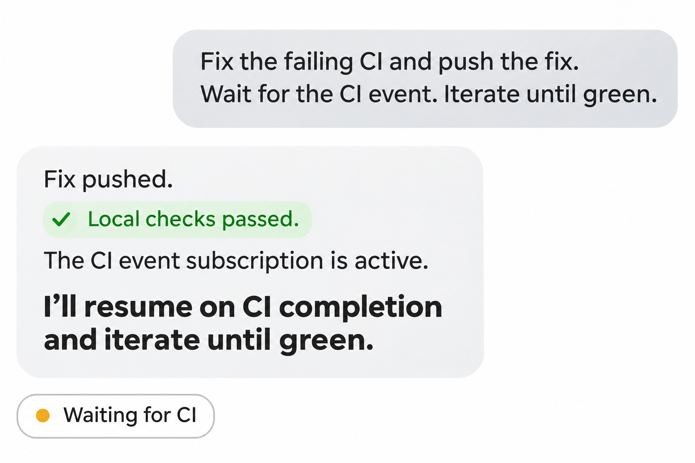

An agent waiting for CI can burn tokens without doing useful work. If
it keeps waking up to check progress, each empty check can trigger
another model turn. Users have reported this in
[Codex](https://github.com/openai/codex/issues/13733) and
[Claude Code](https://github.com/anthropics/claude-code/issues/90443).
I want the harness to handle the wait and resume the agent when a result
arrives.



I added native MCP Events to [Happen](https://github.com/meoyawn/happen)
(my harness) and forked GitHub CLI to give an agent a way to watch CI
between turns.

The illustration paraphrases a real session. The agent pushed a fix,
passed its local checks, and restored a watch for completed CI runs:

```json
{
  "server": "github_events",
  "name": "github.workflow_run",
  "arguments": {
    "branch": "master",
    "workflow": "CI",
    "status": "completed"
  }
}
```

Both successful and failed runs match. On delivery, the agent can check
the commit, inspect a failure, or stop the watch once CI passes.

## A subscription outlives a turn

The [MCP Triggers & Events proposal](https://github.com/modelcontextprotocol/experimental-ext-triggers-events/blob/main/docs/design-sketch-proposal.md)
is experimental. It describes event discovery and three delivery modes:
poll, push, and webhook. Polling happens in the client runtime; an empty
response needs no model call.

In Happen, the model discovers events with `list_mcp_events` and creates
a watch with `subscribe_mcp_events`. The
[subscription belongs to the saved thread](https://github.com/meoyawn/happen/blob/e3a35f579c7d84b657eb649bedf599582c579121/packages/mcp/README.md#experimental-events).
It survives the end of a turn and a disconnected UI. A matching event
enters the thread's inbox and wakes it when idle.

Happen [persists the inbox entry, deduplication receipt, and resume checkpoint together](https://github.com/meoyawn/happen/blob/e3a35f579c7d84b657eb649bedf599582c579121/packages/storage/lib/src/mcp_events.dart#L45).
Archiving the thread removes its watches. On macOS, an active saved watch
also keeps the machine from entering idle system sleep; the display can
still sleep.

## Reusing gh

My [GitHub CLI fork](https://github.com/meoyawn/cli/tree/mcp-events)
adds `gh mcp serve`, a read-only stdio Events server. It uses the existing
gh login and the same repository resolver as `gh browse`, including
`gh repo set-default`. Run it in the project directory. There is no extra
token or webhook endpoint to configure; the
[setup is documented in the fork](https://github.com/meoyawn/cli/blob/e0f789847cc0eeb3cebadcf68eac76400340a995/docs/mcp-events.md).

The fork advertises poll delivery for `github.workflow_run`, with a
default observation interval of 15 seconds. It
[shares the observation cache across subscriptions](https://github.com/meoyawn/cli/blob/e0f789847cc0eeb3cebadcf68eac76400340a995/pkg/cmd/mcp/serve/events.go#L185).
The host filters occurrences before waking the model.

This source samples the latest 100 runs and buffers 512 observed changes.
Intermediate transitions can be missed, and replay does not survive a
gh process restart. A replay gap is reported explicitly.

## What waiting costs

The saving is avoiding model turns that ask whether CI has finished.
The completed-run filter also keeps queued and running updates out of
the conversation. Authentication, repository selection, timers, and
cursors stay in ordinary code.

GitHub requests, host memory, and power still cost something. Keeping a
laptop awake has a battery cost too. I have no measured token or energy
comparison yet. Once the relevant run is green, the agent should call
`unsubscribe_mcp_events` so the watch stops consuming resources.
