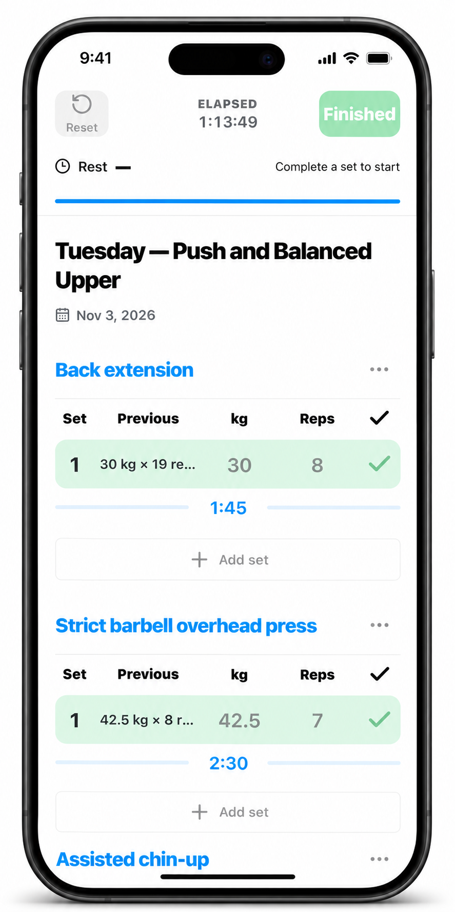

I use ChatGPT on my phone to help manage my strength training. I choose a
goal, follow a program for a training cycle, and record what I do. At the
end of the cycle, we look at the evidence together and decide what comes
next.

The goal is mine. I might want to get stronger, build muscle, get leaner,
or focus on how I look. I can discuss a long-term ambition, then choose
the focus and length of the next cycle. That gives us something specific
to work toward and a point at which to review it.

I use [Strength MCP](https://strengthmcp.com/) to connect the conversation
to my training. It holds two things: my program, written in ordinary
language, and the history of what I actually did. ChatGPT can read both
and save changes to the program when I ask.

The program can describe an established routine, such as Starting Strength
or a Barbell Medicine program, or something we put together in conversation.
I can specify training days, exercises, sets, reps, and rules for increasing
the weight. Those instructions stay with the program, ready for the next
session.

At the gym, I ask ChatGPT to start a workout. It reads the saved program
and gives me a link to the session. I open that on my phone and record my
sets, weights, and reps in a simple web app. Previous results are there
for reference, and I can add notes about how an exercise or the whole
session felt. Planning and discussion happen in chat; the workout screen
is where I keep the record while I train.

<figure class="mx-auto max-w-sm">

<figcaption class="text-center">A completed Tuesday workout in Strength MCP, shown in an iPhone mockup.</figcaption>
</figure>

That history accumulates across sessions. I can ask about my best sets,
compare an exercise over time, or look back at a previous cycle. I can
also import workouts from other apps, so the record can include training
from before I started using this setup.

At the end of the cycle, I return to the conversation. Did I follow the
program? Where did I make progress? Where did I stall? How did the workload
feel? We can pull up the relevant sessions and compare what happened with
what I intended. The log gives us weights, reps, and consistency; I bring
the context of how I feel and whether I'm getting closer to the goal I
chose.

Then we decide what to do with that evidence. Maybe the program is working
and I keep going. Maybe we tune the progression, change the amount of work,
or rewrite the program around a different priority. Once I ask ChatGPT to
save the revision, it becomes the program for future sessions.

The next cycle starts with everything we learned from the last one. I still
have to show up and do the training. The conversation helps me use that work
to make the next decision.
